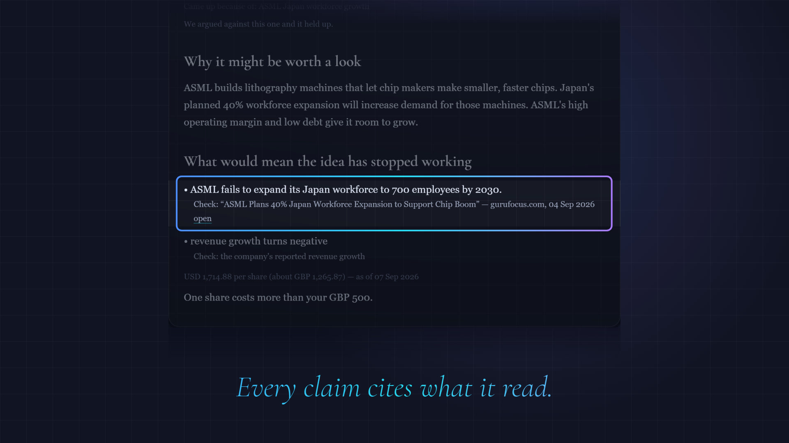

[](https://patharearya.github.io/ai-investment-agent/brag.mp4)
*Click the picture to watch the 20-second video.*

# AI Investment Research Agent

[](https://github.com/patharearya/ai-investment-agent/actions/workflows/tests.yml)

Five LLM agents that research stocks for someone who doesn't know where to
start. You say which sectors interest you, how much risk you can take and what
you want to avoid. It finds what's happening in those sectors, identifies real
public companies exposed to it, **attacks its own conclusions**, and recommends
up to three — or recommends **nothing**, which is a first-class outcome rather
than a blank screen.

Every claim must cite a retrieved article or a measured number, and anything
grounded in neither is discarded and counted.

## Try it

### **[ai-investment-agent-gdjr.onrender.com](https://ai-investment-agent-gdjr.onrender.com)**

Nothing to install and no account or API key. The site has three tabs:

- **Run it** — answer eight questions (age, experience, risk, amount, currency,
  how long, which sectors, anything to avoid) and the five agents run live. Each
  stage appears as it finishes rather than behind a spinner, and a run takes two
  to four minutes. If two of your answers contradict each other it stops and
  asks. You can close the tab: the run carries on and will be waiting when you
  come back.
- **Past runs** — eleven recorded runs across ten sectors, including one that
  recommended nothing. Free to read, and they work even when the day's live runs
  are used up.
- **About** — what it does, what it deliberately will not do, and its limits.

Two things to know before you start:

- **It runs on free tiers.** That is roughly seven live runs a day, shared by
  everyone who visits; the page shows an estimate of what is left. The host
  also sleeps when idle, so the first visit after a quiet spell can take up to a
  minute to load.
- **Narrower researches better.** "Grid storage" produces a sharper brief than
  "utilities".

> **Not investment advice.** A personal learning project, not licensed or
> qualified to advise anyone. Its output should not be acted on.

MIT licensed — see [LICENSE](LICENSE).

---

## What it produces

Each recommendation gives a thesis, the conditions that would break it and what
grounds each one, then what to do next. From a recorded run:

```
     What would mean the idea has stopped working
       • Microsoft secures majority of TSMC capacity for its Maia 300 chip.
           Check: "Microsoft's Maia 300 Chip Targets NVIDIA's AI Dominance"
                  finance.yahoo.com, 16 Aug 2026
       • revenue growth turns negative.
           Check: the company's reported revenue growth
```

The `Check:` line is the point: every condition names either an article the
model was shown or a measured metric. The rest are discarded and counted.

```
  NVDA  USD 217.09 per share   (as of 28 Aug 2026)
        Your USD 1,000 would buy about 4 shares.

  Look at this again on 28 Nov 2026, about three months from now - roughly one
  set of results.
```

**No forecast and no allocation.** It never predicts a price, names a sell date
or says how much to put anywhere, because nothing in the pipeline models any of
those. Prices in another currency are converted at the day's rate and the count
is floored, so it never says you can afford a share you cannot.

### What to expect

**It may recommend nothing, and that is a real answer.** The pipeline is never
forced to produce a pick. It shows the reason instead of a blank screen.

**Sector choice matters more than it looks.** Semiconductors are covered densely
enough to produce a full brief. Renewable energy is dominated by private and
foreign firms, so it can legitimately come back with nothing — the system
working, not breaking.

**Results vary between runs.** It reads the last two weeks of news, so the same
answers on a different day find different companies.

---

## How it works

Five agents on a LangGraph state machine — validate, research, screen, critique,
write — with a few rules holding it together:

- **LLMs judge; Python computes.** Every score, screen and ranking is
  deterministic code. A model asked to score a company 0–100 returns 72 with
  nothing behind it.
- **The model never writes a ticker.** It extracts company *names*; tickers come
  from a market database and are verified. A guessed symbol doesn't look wrong —
  it silently returns a different company's financials.
- **Search first, then synthesise.** Agent 2 retrieves real articles and asks
  the model to read them, rather than asking what matters and hunting for
  support afterwards.
- **What gets filtered out is reported.** "No risks found" means something
  different when four of twelve articles never reached the model.

**[`docs/DESIGN.md`](docs/DESIGN.md)** has the full reasoning and the honest
list of what still goes wrong.

---

## Run it yourself

Only needed to work on the code — the website above runs the same pipeline.

### 1. Install

Python **3.14** is what CI runs on Linux and Windows, and every dependency is
pinned exactly. Older versions are untested rather than known-broken.

```bash
git clone https://github.com/patharearya/ai-investment-agent.git
cd ai-investment-agent
```

```powershell
# Windows / PowerShell
python -m venv .venv
.venv\Scripts\Activate.ps1
pip install -r requirements.txt
```

```bash
# macOS / Linux
python3 -m venv .venv
source .venv/bin/activate
pip install -r requirements.txt
```

### 2. Check it works — no API key needed

```
python -m pytest                                  # 1093 passed, 1 skipped, ~20s, no network
python -m backend.cli --demo                      # prints a recorded run
python -m uvicorn frontend.app:app --port 8000    # the website, locally
```

The local site's Past runs tab works without a key. Run it with ONE worker: the
queue that stops two runs writing to the checkpoint file at once lives in a
single process.

### 3. Add API keys

```powershell
Copy-Item .env.example .env      # Windows
```
```bash
cp .env.example .env             # macOS / Linux
```

Then open `.env` and add:

| Key | Needed? | Free tier | Get one |
|-----|---------|-----------|---------|
| `GROQ_API_KEY` | **Required** | 200k tokens/day | [console.groq.com/keys](https://console.groq.com/keys) |
| `NEWS_API_KEY` | For Agents 2 and 4 | 100 requests/day | [thenewsapi.com](https://www.thenewsapi.com) |
| `FMP_API_KEY` | For Agent 3 | 250 requests/day | [financialmodelingprep.com](https://site.financialmodelingprep.com) |
| `WEB_SESSION_SECRET` | For a deployed site | — | `python -c "import secrets; print(secrets.token_hex(32))"` |

Without the news key the pipeline cannot research anything. Without the FMP key
it still works — non-US companies fall back to `yfinance`, which needs no key.

```
python -m backend.scripts.check_setup
```

Verifies `.env` exists, the settings validate, and the model actually responds.
**Run this first whenever something breaks** — it tells you whether the problem
is your config, the provider, or the code.

### 4. Run it from the command line

```
python -m backend.cli --profile backend/examples/semiconductors_high_risk.json
python -m backend.cli                    # answer the questions yourself; --save-profile mine.json keeps them
python -m backend.cli --list             # saved runs, and which can be resumed
python -m backend.cli --resume <id>      # continue one
```

A run is about a dozen model calls, roughly 25–30k of Groq's daily 200k tokens.
Every step is checkpointed to SQLite, so closing the terminal at a prompt — or
Ctrl-C during the long research call — loses nothing, and resuming does not
repeat the stages that already finished.
`backend/examples/conflicted_crypto.json` contains a contradiction, to see the
pipeline stop, ask, and continue from exactly where it paused.

---

## Tests and evals

```
python -m pytest                        # 1093 passed, 1 skipped; no network
```

The evals make **real API calls** and are how the agents were developed. Start
with `--tag hard`; a full `decision_runner` run costs most of a free day's
tokens.

```
python -m backend.evals.runner                  # Agent 1: 32 labelled cases
python -m backend.evals.runner --tag hard --repeat 3
python -m backend.evals.research_runner         # Agent 2
python -m backend.evals.company_runner          # Agent 3  (runs 2 -> 3)
python -m backend.evals.risk_runner             # Agent 4  (runs 2 -> 3 -> 4)
python -m backend.evals.decision_runner         # Agent 5  (the full chain, most expensive)
```

**Tests and evals answer different questions.** `pytest` proves the code does
what it says — deterministic, no network, always green. The evals call the real
API against known-correct answers and measure the model's *judgment*. That is
probabilistic, so an eval is a measurement to compare across prompt changes, not
a pass/fail gate.

That distinction is the whole project. Every significant defect came from an
eval, never from the test suite — and the suite was green throughout. The
sharpest case: an agent shipped with **351 passing tests and a model that was
never called at all**, because every test stubbed the news client and the
provider silently returned nothing for every live query.

---

## Layout

```
backend/           The research pipeline. Everything that produces a brief.
  cli.py             The command line front end.
  render.py          What a reader is TOLD. Shared, so front ends cannot disagree.
  recordings.py      Loads a recorded run. Used by --demo and by the gallery.
  checkpoints.py     Durable run state, so a stopped run can be resumed.
  config.py          All external configuration. The only place secrets are read.
  workflow.py        The LangGraph graph: nodes, edges, routing.
  models/            Pydantic schemas — the contracts between stages.
  agents/            One module per agent. Prompt + orchestration.
  clients/           The three providers: news, fundamentals, prices.
  evals/             Labelled cases and the scoring runners, one per agent.
  scripts/           Health check, log renderer, and the recording writer.
  examples/          Saved profiles for --profile.
  handoff/           Where to pick the pipeline up.
  tests/

frontend/          The website. One page and the API behind it.
  app.py             The HTTP layer: run, resume, gallery, quota.
  session.py         A signed cookie: which runs a visitor may answer.
  runqueue.py        One run at a time, with a position to report.
  quota.py           How many runs are probably left today, said as an estimate.
  static/index.html  The page. No build step, no framework.
  handoff/           Where to pick the website up.
  tests/

shared/            Recorded runs, read by BOTH halves.
  recorded_run.json  What --demo prints with no API key.
  gallery/           The eleven runs the website shows.

brag-output/       The launch video, its poster, and the scripts that build it.
docs/              DESIGN.md and PROJECT_LOG.md — the whole project, both halves.
conftest.py        Shared test fixtures, at the root so both suites see them.
```

Three folders rather than two, because a recorded run genuinely belongs to
neither half: `backend/cli.py --demo` prints one and the website's gallery shows
eleven. `shared/` names that relationship instead of forcing an owner, and it
keeps the dependency pointing one way — the frontend reads recordings through
`backend/recordings.py`, and the backend never reaches into `frontend/`.

The split is by WHAT PRODUCES THE ANSWER rather than by what runs in a browser.
`frontend/app.py` is server code and lives there anyway, because it belongs to
the website rather than to the pipeline - the line that matters here is which
half a change belongs to, not which machine it executes on.

`render.py` is the one worth knowing about. The CLI used to walk the models and
print in the same breath; a second front end would have been a second set of
decisions about what a reader is told, and two copies of those drift. Content
lives there, layout stays in each front end, and the test of the line is whether
changing it would tell a reader something different or only move the words.

---

## Deploying it

The live site is a Render blueprint: `render.yaml`, free plan. `Procfile`
covers hosts that read one instead. Two things are not preferences:

**One worker.** The queue that stops two runs writing to the same SQLite
checkpoint file lives in a single process. Two workers means two queues, and the
runs-left counter and the queue position would each be counting half the traffic.

**`WEB_SESSION_SECRET` must persist across deploys.** It signs the cookie saying
which runs a visitor may answer; a value that changed on every deploy would stop
anyone resuming a run they had paused.

And one thing to know before it is reported as a bug: on an ephemeral
filesystem, `.state/checkpoints.sqlite` goes with the container, so a paused run
cannot be resumed after a redeploy and the runs-served ledger resets. Nothing a
reader was given is lost — the gallery's recordings are committed files — but a
persistent disk mounted at `.state/` is the first thing to add if it ever gets
real traffic.

The launch video is served separately, from GitHub Pages by
[`.github/workflows/pages.yml`](.github/workflows/pages.yml), so it plays in the
browser instead of downloading.

---

## Known limitations

The short version — [`docs/DESIGN.md`](docs/DESIGN.md) has all of them with
their evidence. Every item here was measured rather than guessed at, and each
names the instrument that would close it and why it was not built.

- **The candidate pool is capped by theme count, not article supply.** Agent 3
  grades (company, theme) pairs, so an uncited article maps to no theme, and
  widening the article list only produces companies with no question to ask
  about them. Telling Agent 2 to cite every supporting article was built and
  measured against a control: it consolidated five themes into three and came
  out worse on every axis. Reverted. The five-theme cap is the real ceiling on
  how many companies can ever be examined.
- **Briefs can be thin.** Roughly three of ten examined companies are
  investable on a renewables theme — most of that news is about private and
  foreign firms. A one-company brief is the honest output, not a broken one.
- **Agent 2 rarely records dissenting evidence**, and **the source filter can't
  cover its long tail** (86 of 130 observed sources contributed exactly one
  article). Both structural, both measured, both accepted deliberately.
- **One of the four exclusion reasons has never fired.** `disqualified_by_risk`
  has unit tests only, deliberately: firing it would mean inventing a critical
  risk, and a fabricated critique proves only that the code runs on a
  fabrication. `restriction_violation` was fired against a real run's candidates
  by substituting the investor's restriction, which is user input and
  legitimately variable.
- **A failed run cannot be resumed.** The graph records the error in state and
  finishes cleanly, so a traceback never reaches a reader. `--list` and
  `--resume` report it as failed, but the four stages already paid for cannot be
  picked up. Recoverable by replaying `decide()` over the checkpoint by hand.
  Ending cleanly and being recoverable are different properties.

---

## The log

**[`docs/PROJECT_LOG.md`](docs/PROJECT_LOG.md) is the interesting half of this
repository.** 145 entries recording what broke, what the first diagnosis was, and
why it was usually wrong — an operating margin of 168 that corrupted two
verified agents, a citation rate blamed on the model that turned out to be
plumbing, the tests-passing-model-never-called story above, and a widening fix
that was built, measured against a control, found worse on every axis and
reverted — where the finding was worth more than the change would have been.

The code shows what was built. The log shows how it was found out.
